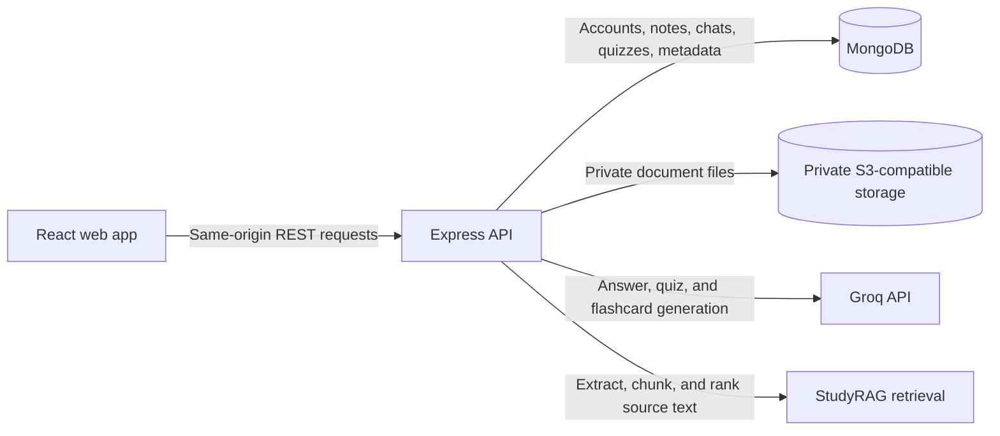

# StudyRAG

**StudyRAG is a private AI study workspace for learning from your own documents, notes, and saved web pages.** Upload course materials, ask questions in English or Hinglish, get source-grounded explanations, and turn what you learn into quizzes and flashcards.

> Current state: the core personal-workspace features are implemented. The production Docker setup is in the repository, but a public deployment still needs a hosting service, hosted MongoDB, private object storage, and production secrets. See [Deployment](#deployment) and [Known limitations](#known-limitations).

## What it does

| Area | What you can do |
|---|---|
| AI chat | Have a general conversation or ask questions about selected documents, web pages, and notes. Source-based answers can include citations. Conversation history and source filters are saved. |
| Documents | Upload, search, rename, preview, and download private PDF, DOCX, and TXT study files. |
| Web sources | Add public web pages to your study library, refresh their text, and ask questions about them. |
| Notes | Create and edit notes, format content, search by title/body/tags, and organize notes in folders. |
| Quizzes | Generate multiple-choice practice quizzes from selected documents or web sources, save them, and review attempts. |
| Flashcards | Generate and save study decks from selected documents or web sources. |
| Study workspace | Track assignments and tasks, review saved passages, and see due-date reminders and personal workspace activity. |
| Account and privacy | Manage your profile and password, export workspace data, and use authenticated sessions. User records and sources are private to their owner. |
| Admin dashboard | An owner-promoted admin can see account and aggregate activity information plus service health. The dashboard does not show private chat or note contents. |

## How it works



The browser never connects directly to MongoDB or Groq. The server authenticates requests, checks resource ownership, retrieves relevant passages from the signed-in user's selected sources, and then calls Groq for generation. Retrieval currently uses keyword ranking; StudyRAG does not require a local model, Ollama, embeddings, or a vector database.

For document-grounded questions, answers are based on retrieved passages and may include citations. For greetings and general questions, the chat can respond conversationally without claiming the answer came from a document. If no relevant source passage is found, the grounded chat reports that instead of inventing a source-based answer.

## Technology

- **Frontend:** React, Vite, React Router, Tailwind CSS, Lucide icons
- **API:** Node.js, Express 5, Mongoose, Zod
- **Database:** MongoDB
- **AI generation:** Groq API; the key stays on the server
- **File storage:** private local disk for development; private S3-compatible storage (including Cloudflare R2) for production
- **Deployment:** Docker image builds the client and serves it with the API from one service

## Repository map

```text
client/                 React application
  src/features/         Feature pages (chat, documents, notes, quizzes, admin, ...)
  src/services/         Browser API clients
  src/context/          Authentication and shared client state
server/                 Express application
  src/config/            Environment, database, and storage setup
  src/controllers/       HTTP request handlers
  src/middleware/        Authentication, validation, limits, and errors
  src/models/            MongoDB/Mongoose models
  src/routes/            Versioned REST API routes
  src/services/          Feature logic, retrieval, and AI integration
  scripts/               Runtime, integration, admin, and storage commands
docs/                    Architecture, API, schema, and decision documents
Dockerfile               Production web and API container
.github/workflows/       Build, runtime, and container CI checks
```

## Run locally

### Requirements

- Node.js 24 recommended (Node.js 20.19+ is required by the current Vite toolchain)
- npm
- MongoDB Community running locally, or a MongoDB connection string
- A Groq API key for AI-generated answers, quizzes, and flashcards

### Setup

1. Clone the repository and open a terminal in its root folder.
2. Install the server dependencies:

   ```bash
   npm ci --prefix server
   ```

3. Create `server/.env` from the template. In PowerShell:

   ```powershell
   Copy-Item server/.env.example server/.env
   ```

   In macOS/Linux:

   ```bash
   cp server/.env.example server/.env
   ```

4. In `server/.env`, set `MONGODB_URI`, replace `JWT_ACCESS_SECRET` and `JWT_REFRESH_SECRET` with different random values of at least 32 characters, and add `GROQ_API_KEY` for AI features. Keep `.env` private and do not commit it.
5. Install the client dependencies:

   ```bash
   npm ci --prefix client
   ```

6. Start the API in one terminal:

   ```bash
   npm --prefix server run dev
   ```

7. Start the web app in another terminal:

   ```bash
   npm --prefix client run dev
   ```

8. Open the Vite address shown in the terminal, usually `http://localhost:5173`. Vite forwards `/api` requests to the local API at `http://localhost:4000`.

The complete variable list and development defaults are in [`server/.env.example`](server/.env.example). Local development uses `STORAGE_PROVIDER=local`; uploaded files are kept in the ignored `server/storage/` directory.

## Environment settings

| Variable | Required? | Purpose |
|---|---:|---|
| `NODE_ENV` | Production | Set to `production` on the deployed service. |
| `PORT` | Host-dependent | HTTP port; deployment platforms commonly provide this automatically. |
| `MONGODB_URI` | Yes | MongoDB connection string. Use a hosted database for deployment. |
| `JWT_ACCESS_SECRET` | Yes | Secret for short-lived access tokens; use a unique random value (32+ characters). |
| `JWT_REFRESH_SECRET` | Yes | Separate secret for refresh sessions; use a unique random value (32+ characters). |
| `FRONTEND_ORIGIN` | Yes in production | Exact public site origin, such as `https://studyrag.example.com`. The production container serves client and API from the same origin. |
| `GROQ_API_KEY` | AI features | Server-only Groq credential. Never use a `VITE_` variable for this key. |
| `GROQ_MODEL` | Optional | Groq model name; defaults to `openai/gpt-oss-20b`. Check Groq's current model list and limits before launch. |
| `STORAGE_PROVIDER` | Production | Use `s3` in production. Production startup rejects local disk storage. |
| `S3_ENDPOINT`, `S3_REGION`, `S3_BUCKET` | Production | Private S3-compatible object store endpoint, region, and bucket. |
| `S3_ACCESS_KEY_ID`, `S3_SECRET_ACCESS_KEY` | Production | Bucket-scoped storage credentials with object read/write/delete access. |
| `SMTP_HOST`, `SMTP_PORT`, `SMTP_FROM` | Optional | Enables email verification and password recovery; configure together. `SMTP_USER` and `SMTP_PASS` are optional together. |
| `COOKIE_SAME_SITE` | Optional | Defaults to `lax`. Use `none` only for a cross-site frontend/API setup and only with secure cookies/HTTPS. |

## Checks

Build the frontend:

```bash
npm --prefix client run build
```

Check the server syntax and load the Express app:

```bash
npm --prefix server run check
npm --prefix server run check:runtime
```

The integration smoke flow needs a reachable MongoDB and a configured Groq key. It creates temporary accounts, uploads and indexes synthetic sources, exercises key user workflows, and removes its temporary database records and uploaded files afterward:

```bash
npm --prefix server run check:integration
```

Do not run the integration command against a production database. GitHub Actions checks the frontend build, server syntax/runtime imports, and production Docker image on pushes and pull requests to `main`.

## Deployment

The root [`Dockerfile`](Dockerfile) builds the React app and runs the website and Express API together. The same-origin setup avoids separate frontend/API cookie and CORS configuration. The image exposes port `4000`, respects the hosting platform's `PORT`, and provides `/api/v1/health` as its health check.

1. Create a Docker-capable web service from the repository root.
2. Create a hosted MongoDB database and a **private** S3-compatible bucket. Give the bucket key only the object permissions the app needs.
3. Add the required environment values in the host's secret manager: `NODE_ENV=production`, `MONGODB_URI`, two separate JWT secrets, `FRONTEND_ORIGIN`, `STORAGE_PROVIDER=s3`, and all five S3 settings. Add `GROQ_API_KEY` to enable AI generation. Add SMTP settings if email verification and password recovery are needed.
4. Set `FRONTEND_ORIGIN` to the deployed site origin exactly, including `https://` and excluding a trailing slash. Use HTTPS for the public site. Production automatically enables secure cookies.
5. Deploy and confirm the health check is healthy. Check logs and test signup, login, file upload/download, chat, and a page refresh on a nested route.
6. Create your account, promote it to admin using the command below against the **same hosted MongoDB**, then sign out and sign in again.

Build the image locally with:

```bash
docker build -t studyrag .
```

The app intentionally stops in production if MongoDB or durable object storage is missing. This prevents uploads from silently being saved to an app host's temporary disk.

### Make your account an admin

Create an account through the site first, then run this from the `server/` directory with environment variables pointing at the deployed database:

```bash
npm run admin:promote -- owner@example.com
```

For hosted deployment, use the provider's one-off command/console with the same production environment. Admin privileges cannot be granted through public signup. Admin APIs verify the account role on the server for each request.

### Move existing data

Deployment does not automatically copy data from your laptop. MongoDB records and uploaded document files are separate:

- To keep existing accounts, notes, conversations, quizzes, and other records, migrate or restore the **MongoDB database** into the hosted MongoDB instance.
- To move existing uploaded files referenced by that same MongoDB database, configure the private bucket and local `DOCUMENT_STORAGE_DIR`, then run `npm run storage:migrate` from `server/` with `STORAGE_PROVIDER=s3` and the correct bucket/database settings.
- The file migration command copies document binaries only; it does not migrate MongoDB data. Confirm files open from the deployed app before deleting local copies.

Profile photos are currently stored in the browser's local storage. They remain on that browser but do not sync across devices or get included in server backups.

## Security and privacy

- Passwords are hashed; refresh sessions use HTTP-only cookies and can be revoked.
- API routes validate input, apply authentication/ownership checks, use rate limits for sensitive actions, and return request IDs with errors.
- Uploaded files are private and served only after authenticated ownership checks. Web-source fetching blocks private/local network targets and limits response size and redirects.
- Chat retrieval only searches sources owned by the signed-in user. Retrieved source content is treated as reference data rather than trusted instructions.
- Provider and database credentials belong in server/hosting secret settings, never in client code or Git.
- See [SECURITY.md](SECURITY.md) for the security notes and [docs/ARCHITECTURE.md](docs/ARCHITECTURE.md) for the request flow.

## Known limitations

- Keyword retrieval is used; semantic/vector search is not included.
- Groq usage is subject to model availability, rate limits, and account quota. There is no local model fallback or automatic paid-provider fallback.
- Web ingestion supports public HTML pages, not login-protected sites, JavaScript-rendered pages, or web-hosted PDFs.
- Email verification and password recovery need SMTP configuration.
- Notifications are refreshed when a signed-in user opens the notifications page; scheduled email/push delivery is not implemented.
- Team/class sharing is not implemented; workspaces are personal and owner-scoped.
- A Docker image is ready, but the app is not considered deployed until cloud services and production secrets have been configured and a live deployment has been verified.

## Project documentation

- [Architecture](docs/ARCHITECTURE.md)
- [Database schema](docs/DATABASE_SCHEMA.md)
- [API routes](docs/API.md)
- [Security notes](SECURITY.md)
- [Free-service evaluation](FREE_SERVICES.md)
- [Architecture decisions](DECISIONS.md)
- [Project status](PROJECT_STATUS.md)

## License

No license file is currently included. Contact the repository owner before reusing or redistributing this project.
